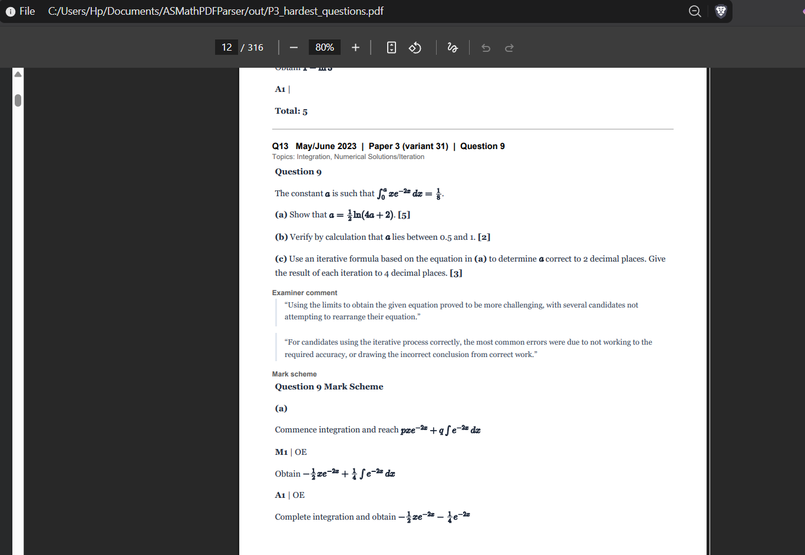
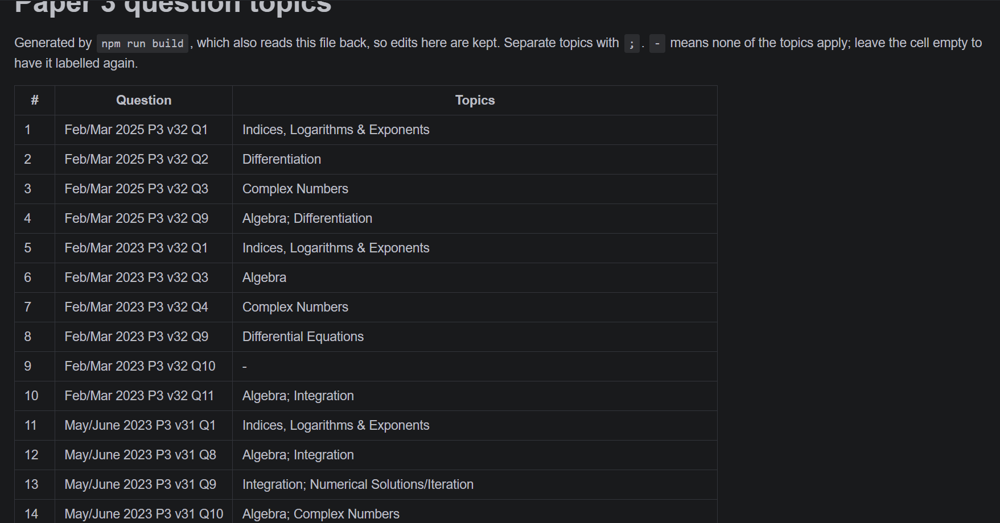

# ASMathPDFParser

Cleans up the CAIE 9709 "hardest questions" PDF into a Paper 3 booklet you can actually study from, with every question tagged by topic.

<p>
  
  
</p>

What it does to the original 1636-page PDF:

- Drops the Paper 1 questions and keeps the 326 from Paper 3.
- Strips the watermark, badges, headers and footers, and packs the content onto plain A4 pages (about 316 pages). The maths stays sharp.
- Shows each question first, then the examiner's comment, then the mark scheme.
- Tags each question with one or more topics using a free AI model: Algebra; Indices, Logarithms & Exponents; Trigonometry; Differentiation; Integration; Differential Equations; Complex Numbers; Numerical Solutions/Iteration.

## Setup

You need Node.js 22 or newer and a free [OpenRouter API key](https://openrouter.ai/keys).

```bash
npm install
cp .example.env .env
```

Put your key in `.env` after `OPENROUTER_API_KEY=`, then run:

```bash
npm run build
```

The first run takes a few minutes. You'll get three files in `out/`:

- `P3_hardest_questions.pdf`: each question followed by its comment and mark scheme
- `P3_questions_then_answers.pdf`: all the questions first, with comments and mark schemes at the back
- `labels.md`: every question and its topics, plus a list of questions by topic

## Good to know

- Every run overwrites the files in `out/`. Close the PDFs first, or Windows won't let them be replaced.
- Labels are saved in `out/labels.md` and reused, so only new or cleared questions go to the AI. You can fix a label by editing that file. `npm run relabel` labels everything again from scratch.
- Free models allow 50 requests a day, and a full labelling run uses about 16. If you hit the limit, progress is saved; just run it again later.
- `npm run build:no-label` builds the PDFs without calling the AI.
- `npm test` runs the tests, and `npm run typecheck` checks types. Neither needs the AI.
- Optional settings (models to use, images per request) are listed in `.example.env`.
